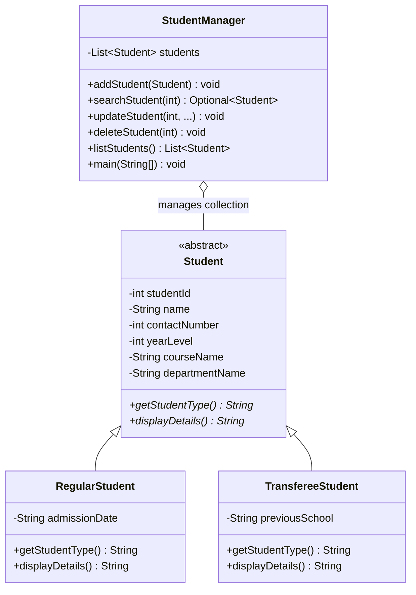
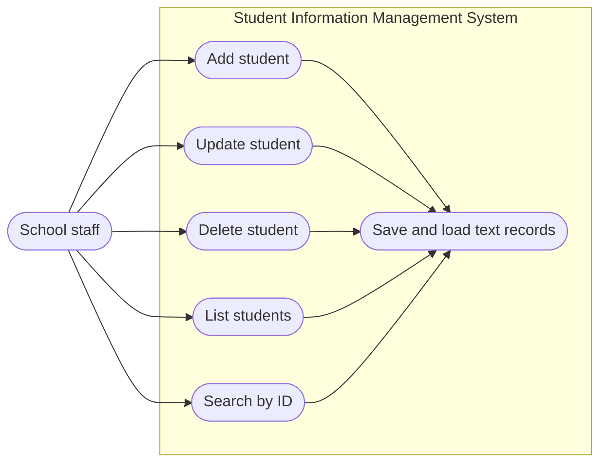
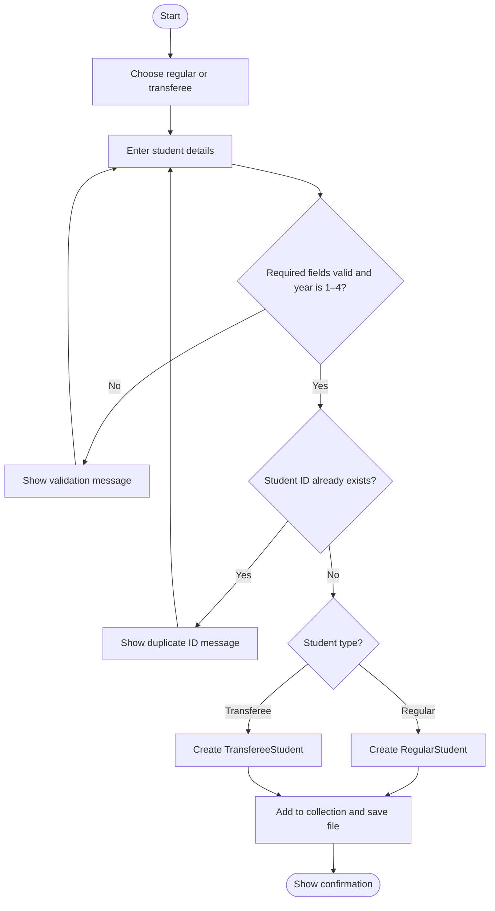
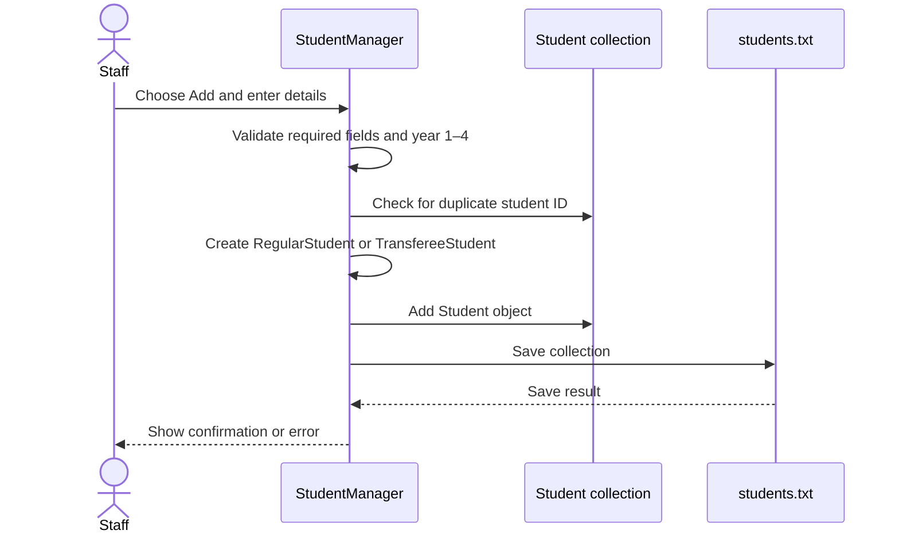

# SIMS UML Design

The design is limited to four classes and matches the Java implementation.

## Class diagram

## Use case diagram

## Activity diagram: add a student

## Sequence diagram: add a student

## Scope notes

Student ID and contact number use `int`, so leading zeros and 11-digit contact values cannot be represented. There is no address field/class, status field, course code, department code, or separate course and department classes. Course and department names are stored directly on `Student`. `StudentManager` includes the menu, validation, CRUD operations, and text-file persistence so the project remains at four Java classes.
