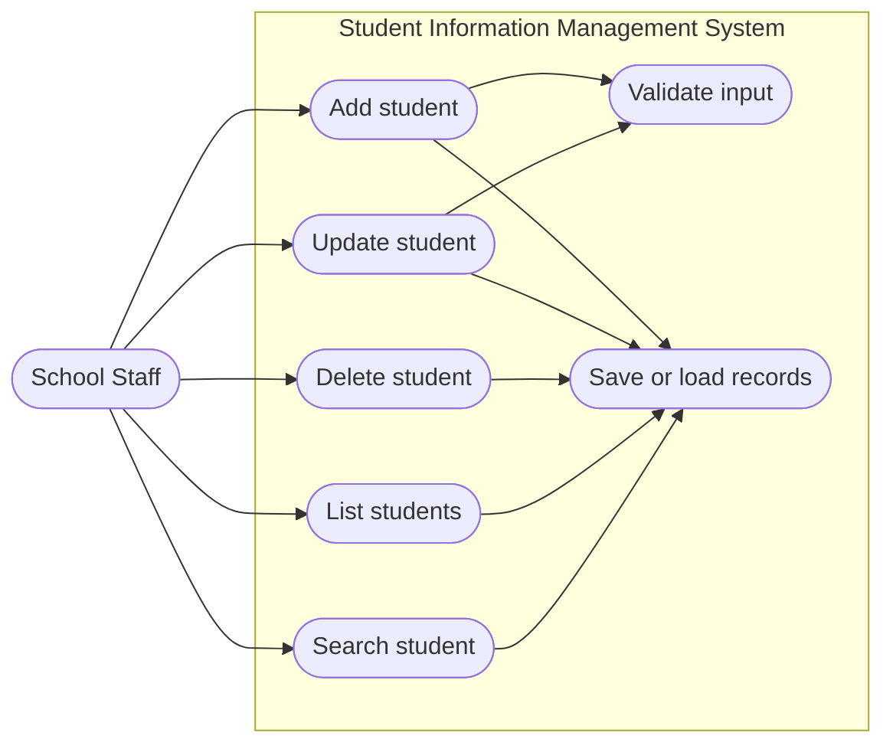
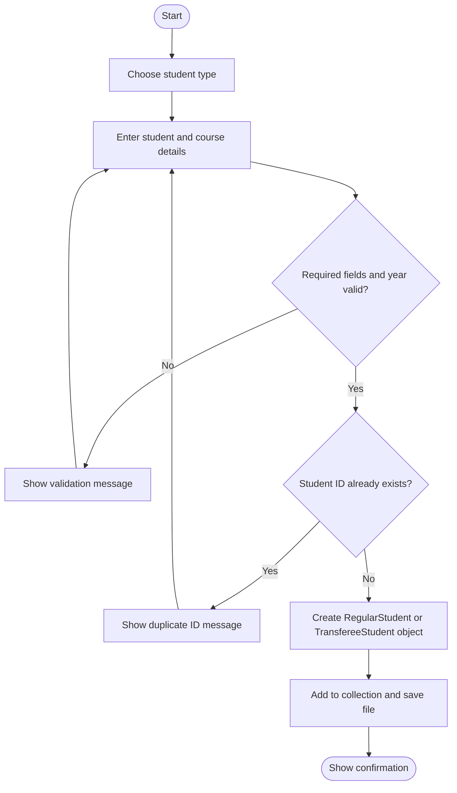
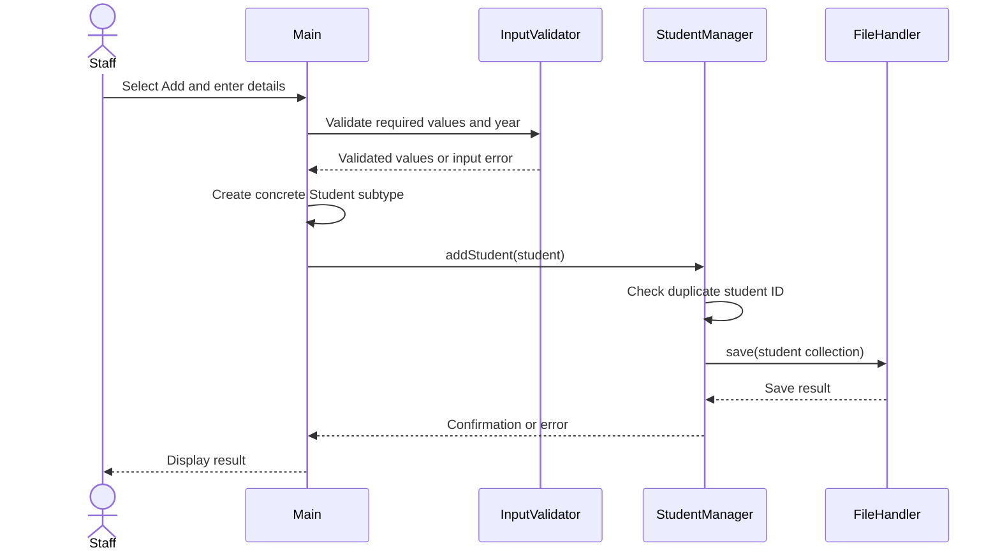

# SIMS UML Design

These diagrams describe the initial Java console implementation. Update them if the code or agreed project scope changes.

## Use case diagram

## Activity diagram: add a student

## Sequence diagram: add a student

## Class diagram

See [`student_management_class_diagram.png`](student_management_class_diagram.png) for the updated class diagram.

## Design notes

- The system uses a `List<Student>` collection, with concrete student subtypes stored polymorphically.
- `StudentManager` owns record operations, `InputValidator` checks user input, and `FileHandler` handles persistence.
- `Address`, `Course`, and `Department` are associated data classes. Course and department are represented by names; code fields and student status are not part of the model. Year level is limited to 1–4.
- The diagrams describe the design, not test results. Add test outcomes only after the group runs and records the tests.
