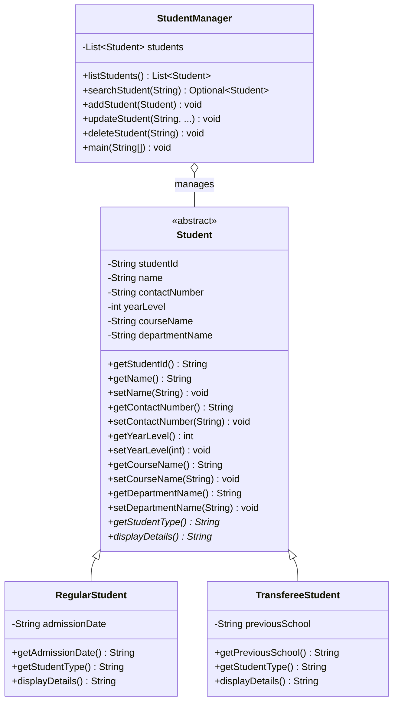
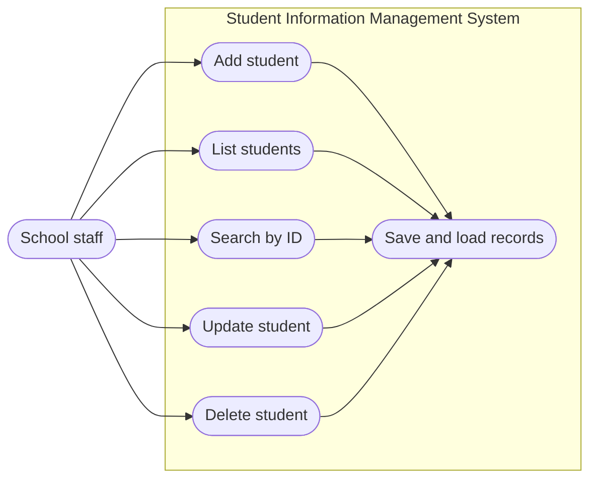
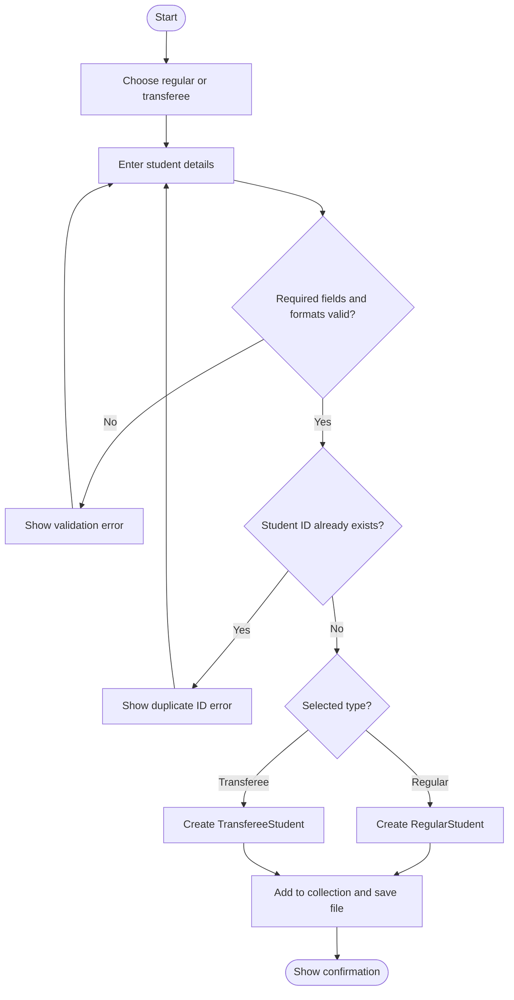
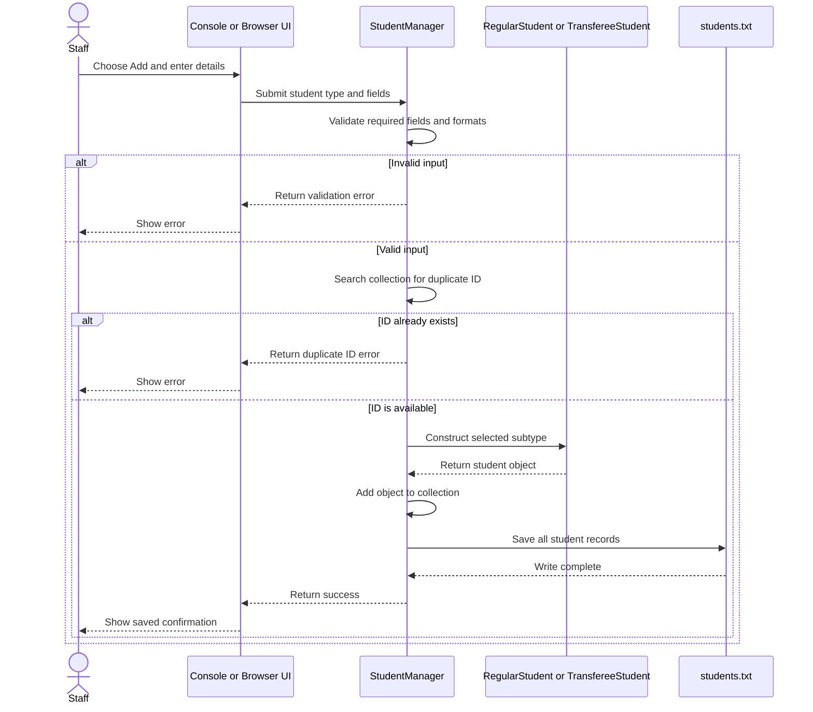

# Phase 3 – System Analysis and UML Design

This supplement provides the four required diagrams in Mermaid notation. The class diagram matches the current Java source. Use it in place of the older PNG class diagram, whose field types and subtype details do not match the implementation.

## Class diagram

## Use case diagram

## Activity diagram: add a student

## Sequence diagram: add a student

The console menu or browser form collects the input. `StudentManager` validates fields, rejects duplicate IDs, creates the selected student subtype, updates its collection, and saves the records.

## Model consistency

The Java source stores student IDs and contact numbers as `String` values, preserving the ID hyphen and phone-number leading zero. The diagram reflects those types and the regular/transferee subtype fields and methods. The older `student_class_diagram.png` does not match these details; use the class diagram above for the project report.
